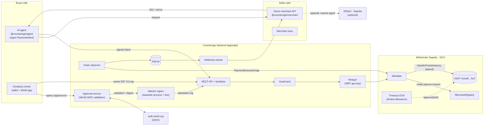
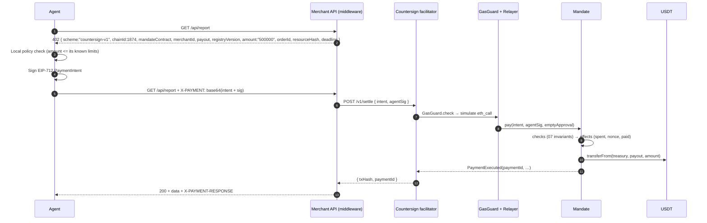
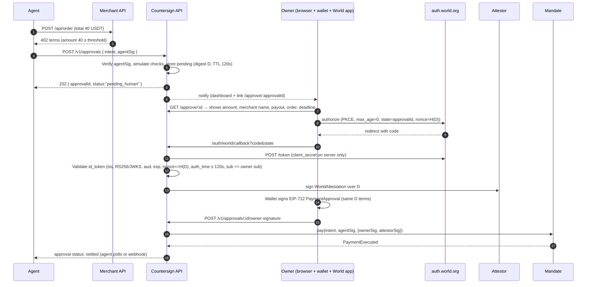

# 02 · Architecture

## 1. Principles

1. **The contract is the security boundary.** The backend, relayer and frontend are helpers. None of them alone can move funds or change payment terms.
2. **Agents never hold value.** Funds move `treasury → payout` inside `Mandate.pay()` via `transferFrom` on a limited allowance.
3. **Every payment term is signed.** Amount, merchant, payout address, registry version, order, epoch and deadline are in the signed digest.
4. **Separate keys, separate powers.** World attestor, relayer and owner are different keys. A single compromised key can't pay a tampered or over-limit payment.
5. **Status comes from chain logs**, never from a client callback.

## 2. Components



## 3. Trust model

| Component | Can it move funds alone? | If compromised |
|---|---|---|
| `Mandate` contract | Yes, within the allowance and its own rules | Loss is capped by the treasury allowance, so keep it small. Pause switch. |
| Agent key | No. It can sign intents only within per-tx, period and threshold limits, to allowlisted merchants. | Attacker spends up to the remaining period budget below the threshold. Revoke via epoch. |
| Owner wallet | No, above threshold it needs the World attestation too | Attacker still needs a fresh World sign-in as the owner |
| World attestor key | No, it needs the owner's signature on the same digest | Attacker still needs the owner wallet. Rotate the attestor via the owner. |
| Relayer key | No. It only pays gas. | Attacker drains WBT up to the GasGuard budget. Funds stay safe. |
| Backend DB | No | Wrong statuses or webhooks. The chain is the source of truth. |
| `MerchantRegistry` owner of a merchant | Can change its own payout | Old approvals become invalid (version check). It can't redirect signed payments. |

**Residual risk to state in the README:** an attacker with both the owner wallet **and** the attestor key could approve payments up to the hard caps. That's why the allowance stays small and the caps are hard.

## 4. Flow A: small payment (below threshold), fully automatic



## 5. Flow B: risky payment, 2-of-2 human approval



**Failure paths (all must be demoable):**

| Path | What happens | Result |
|---|---|---|
| Owner cancels at World | `access_denied` on callback | No attestation, status `denied` |
| Owner waits more than 120s | Approval TTL passes, or `deadline` passes onchain | No attestation, status `expired`. Late signatures revert `Expired`. |
| Different World user signs in | `sub` ≠ registered owner `sub` | No attestation, status `wrong_human` |
| Stale session reused | `auth_time` older than 120s | Rejected, status `stale_auth` |
| Backend tries to swap merchant | Owner signed digest D, attestor signed D' | `pay()` reverts `BadApproval` |

## 6. Flow C: revoke

Owner clicks Revoke. The owner wallet calls `Mandate.revoke(mandateId)` (owner pays gas, or the relayer submits an owner-signed revoke). `epoch++`. Any intent or approval signed with the old epoch reverts `StaleEpoch` once the revoke transaction has executed. Payments mined before it stay final.

## 7. Flow D: refund (P1)

The merchant payout wallet approves `Mandate` once for refunds. The merchant clicks Refund in the merchant view, which calls `refund(paymentId, amount)` from the payout wallet (merchant pays gas, since the merchant is the business, not the payer). The contract enforces `refunded + amount ≤ paid` and moves `payout → treasury`, emitting `PaymentRefunded`.

## 8. Repo layout

```
countersign/
  contracts/            Foundry: src/Mandate.sol, src/MerchantRegistry.sol, test/, script/
  apps/api/             Fastify + viem + better-sqlite3: API, facilitator, approvals, relayer, observer, webhooks
  apps/attestor/        Tiny separate service holding ATTESTOR_KEY, signs only validated digests
  apps/web/             Next.js: owner dashboard, /approve/:id, merchant view, demo controls
  apps/demo-merchant/   Separate Express app using @countersign/merchant (the "20 lines")
  apps/demo-agent/      Node script: buys report, places order, attack scenarios
  packages/merchant/    @countersign/merchant middleware
  packages/agent/       @countersign/agent client
  packages/shared/      EIP-712 types, ABIs, constants (chain 1874, USDT address)
  docs/                 these files
  README.md  WHITECHAIN_FEEDBACK.md  WORLD_DEBRIEF.md
```

## 9. Configuration

```env
CHAIN_ID=1874
RPC_URL=https://rpc.testnet.whitechain.io
EXPLORER=https://explorer.testnet.whitechain.io
USDT=0xcedfB56113143d55b2358b8CFbB0dEB5Ad2f55a7
MANDATE=0x...            # after deploy
REGISTRY=0x...
RELAYER_KEY=0x...        # WBT only
ATTESTOR_KEY=0x...       # attestor service only, never in apps/api
WORLD_ISSUER=https://sandbox.auth.world.org   # auth.world.org in production
WORLD_CLIENT_ID=...
WORLD_CLIENT_SECRET=...  # server only
WORLD_REDIRECT_URI=https://<host>/auth/world/callback
APPROVAL_TTL_SECONDS=120
GASGUARD_DAILY_WBT=0.2
```

Check USDT `decimals()` at startup and never hard-code 6.
