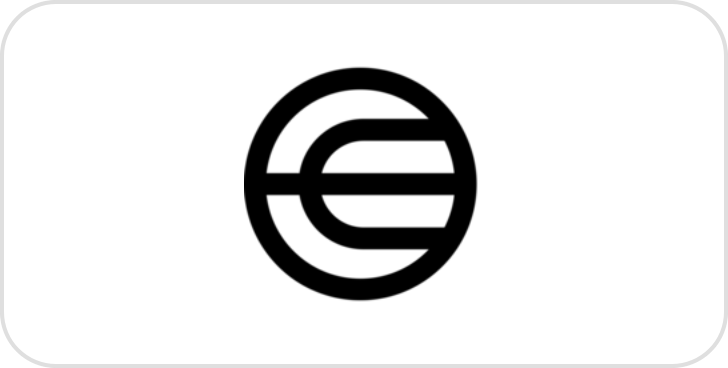
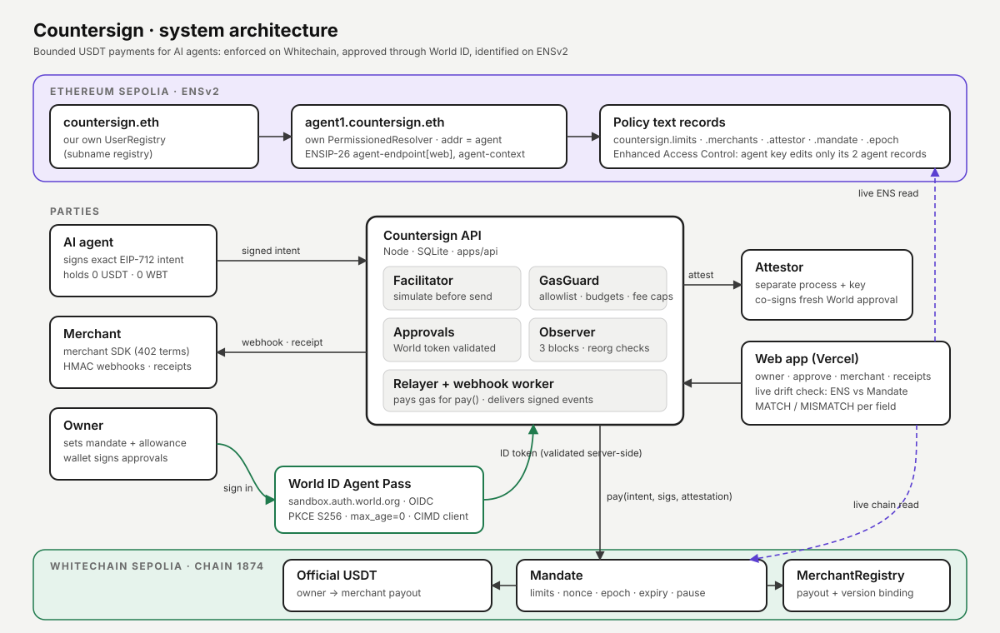
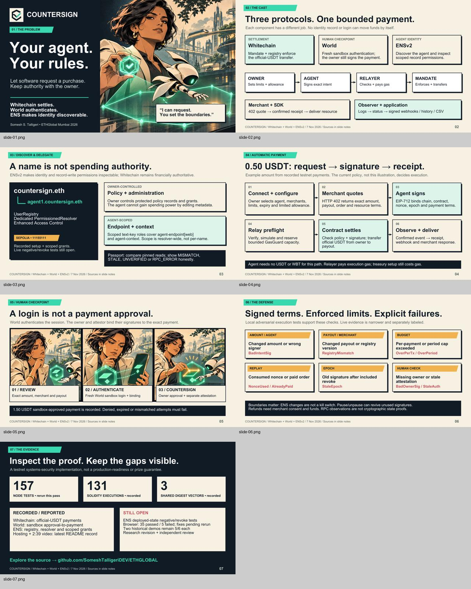

<div align="center">
  
  <h1>Countersign</h1>
  <p><strong>Agents have identities. Identities have permissions. Payments have proofs.</strong></p>
  <p>Bounded agent payments with Whitechain, World and ENSv2.</p>

  <a href="#whitechain-settlement-and-spending-policy"></a>
  <a href="#world-human-authentication-and-exact-approval"></a>
  <a href="#ensv2-identity-and-authority"></a>
  <br />
  <a href="presentation/evidence/node-tests.txt"></a>
  <a href="#tests-and-research-reproducibility"></a>
  <a href="research/PUBLICATION-STATUS.md"></a>
  <a href="#release-status"></a>
  <br />
  <a href="https://countersign.someshtalligeri12.workers.dev"></a>
  <a href="https://countersign-api-44lz.onrender.com/health/ready"></a>
  <a href="https://ethglobal.com/events/mumbai"></a>
  <br />
  
  
  
  
  
  
  <a href="https://github.com/SomeshTalligeriDEV/Countersign/actions"></a>

  <p>
    <a href="https://countersign.someshtalligeri12.workers.dev"><strong>Open app</strong></a> ·
    <a href="#demo-video">Demo &amp; transactions</a> ·
    <a href="https://countersign.someshtalligeri12.workers.dev/release/countersign-deck.pdf">Pitch deck</a> ·
    <a href="research/paper/COUNTERSIGN-Research-Paper.pdf">Research paper</a> ·
    <a href="#repository-and-setup">Build locally</a>
  </p>
</div>

---

An autonomous agent should be able to request a purchase without receiving unrestricted control of a treasury. **Countersign binds each protected payment to exact signed terms and an owner-configured spending policy.** Sensitive payments additionally require fresh World sandbox authentication, an attestor assertion and the owner's signature.

| Whitechain | World | ENSv2 |
|---|---|---|
| **Enforce the payment.** Mandates, merchant payout binding, limits, replay protection and official-USDT settlement. | **Authenticate the human.** Fresh sandbox authentication, session/subject binding and a separate exact-payment approval. | **Discover the agent.** Hierarchical identity, scoped resolver permissions and inspectable policy references. |
| Financial authority lives in the payment contract. | A login alone cannot authorize a transfer. | Editing identity metadata cannot grant spending rights. |

> **Evidence first.** This is a testnet systems-security implementation. Local tests, recorded transactions and unverified integration paths are labeled separately. It is not independently audited or production-ready. Badge counts are recorded checkpoints, not live CI status.

**Navigate:** [How it works](#what-countersign-protects) · [Architecture](#what-countersign-protects) · [Deployments](#recorded-deployments-and-settlement) · [Security](#security-boundaries) · [Research](#research-draft) · [Disclosures](#sponsor-alignment-and-disclosures)

## ETHGlobal Mumbai 2026 · prize tracks

| Track | What we built for it | Proof |
|---|---|---|
| **Whitechain · Stablecoin Payments / Payments Nobody Notices** | Mandate + MerchantRegistry contracts (verified) enforce per-payment cap, period budget, merchant allowlist, expiry, pause and epoch. The agent holds 0 USDT / 0 WBT; the relayer sponsors gas under GasGuard limits; payments settle in **official testnet USDT** in seconds. | [Payment 0xefc8692e…](https://explorer.testnet.whitechain.io/tx/0xefc8692e551bfdef4f468f85bee2e1a06d4491432a24e3277776b53c177a3c3d) · [pause](https://explorer.testnet.whitechain.io/tx/0x1a232e63524f6a992271cccdee1e37122366f03d5cdc5aa86f8714c370ccf9cc) / [unpause](https://explorer.testnet.whitechain.io/tx/0x97d66455a328b2b8cb5cc434c7635ff20f557ee74f948cdeb9ea6fd58a2f4d98) |
| **World · Agent Pass** | Payments above the threshold require fresh World Agent Pass sign-in (OIDC, PKCE S256, `max_age=0`, CIMD public client), then the owner signs the **exact** payment and a separate attestor co-signs. | [World-approved 1.50 USDT](https://explorer.testnet.whitechain.io/tx/0x98fa814e805ab35e55124370539bc0c1889aef519d5c408800be2efc709cb531) · [proof](docs/proof/A2-world-approval.md) |
| **ENS · Best Use of ENSv2** | `countersign.eth` with our own UserRegistry; `agent1.countersign.eth` with its own PermissionedResolver, ENSIP-26 agent records, policy text records and scoped role grants. The live app compares every ENS policy field against the Whitechain contract (**7/8 MATCH**). | [Live passport](https://countersign.someshtalligeri12.workers.dev/agent/agent1.countersign.eth) · [ENS transactions](docs/proof/A15-ens-onchain.md) |

## Built on Whitechain · World · ENS

Three protocols, three jobs, one payment that cannot go wrong. Each one does what it is best at, and none can move money alone.

<table>
<tr>
<td width="33%" align="center" valign="top">
<br />
<h3>Whitechain</h3>
<b>The contract is the judge.</b>
</td>
<td width="33%" align="center" valign="top">
<br />
<h3>World ID · Agent Pass</h3>
<b>A real human, on the exact payment.</b>
</td>
<td width="33%" align="center" valign="top">
<br />
<h3>ENSv2</h3>
<b>Agents get a name and a public policy.</b>
</td>
</tr>
<tr>
<td valign="top">

**What we built**
- `Mandate` + `MerchantRegistry`, deployed and **source-verified** on Whitechain Sepolia (1874)
- Every rule enforced on-chain: per-payment cap, period budget, merchant allowlist, payout binding, expiry, pause, nonce, epoch
- Settles in **official testnet USDT**; the agent holds 0 USDT and 0 WBT, and our relayer sponsors gas within GasGuard limits

**Why Whitechain**
EVM-compatible and fast, with fees low enough that **50-cent agent purchases make sense**: payments nobody notices, enforced by code nobody can bypass.

[`Mandate.pay()`](https://github.com/SomeshTalligeriDEV/Countersign/blob/acf3c9e7b9bc3b183f2ace167cec9bd34a62f614/contracts/src/Mandate.sol#L235-L267) · [live payment](https://explorer.testnet.whitechain.io/tx/0xefc8692e551bfdef4f468f85bee2e1a06d4491432a24e3277776b53c177a3c3d)

</td>
<td valign="top">

**What we built**
- Above the owner's threshold, payments **stop** until the owner signs in with World Agent Pass
- OIDC + PKCE S256, `max_age=0` (fresh auth every time), CIMD public client, ID token checked against World's published keys
- The owner signs the **exact** payment; a separate attestor co-signs; the contract rejects stale or missing attestations

**Why World**
A login is not a payment approval. World proves a **unique human** is present, and we bind that proof to one amount, one merchant, one order.

[on-chain approval check](https://github.com/SomeshTalligeriDEV/Countersign/blob/acf3c9e7b9bc3b183f2ace167cec9bd34a62f614/contracts/src/Mandate.sol#L260-L294) · [World-approved payment](https://explorer.testnet.whitechain.io/tx/0x98fa814e805ab35e55124370539bc0c1889aef519d5c408800be2efc709cb531)

</td>
<td valign="top">

**What we built**
- `countersign.eth` with **our own UserRegistry**; `agent1.countersign.eth` with its **own PermissionedResolver**
- ENSIP-26 `agent-endpoint[web]` + `agent-context`, plus the spending policy published as text records
- Scoped roles: the agent key edits only its two agent records, never the policy; live **ENS vs chain** check (7/8 MATCH)

**Why ENSv2**
Hierarchical registries and resource-scoped permissions turn a name into a **verifiable agent passport** that anyone can audit against the contract.

[ENS module](https://github.com/SomeshTalligeriDEV/Countersign/blob/acf3c9e7b9bc3b183f2ace167cec9bd34a62f614/packages/ens/src/index.mjs#L51-L139) · [on-chain records](docs/proof/A15-ens-onchain.md) · [live passport](https://countersign.someshtalligeri12.workers.dev/agent/agent1.countersign.eth)

</td>
</tr>
</table>

### Tech stack

| Layer | Technologies |
|---|---|
| Smart contracts | Solidity 0.8.30, Foundry 1.9, OpenZeppelin Contracts 5.4, EIP-712, ERC-1271 |
| Chains | Whitechain Sepolia (1874) for settlement · Ethereum Sepolia for ENSv2 |
| Backend | Node.js 24, viem 2.35, SQLite, WebSocket events, HMAC webhooks, separate attestor process |
| Identity | World Agent Pass (OIDC, PKCE, CIMD), ENSv2 UserRegistry + PermissionedResolver, ENSIP-26 |
| Frontend | Next.js 16, React, Tailwind CSS, comic and manhwa design system |
| Hosting | Cloudflare Workers (OpenNext) · Render (Docker) · Vercel mirror |
| Quality | Foundry unit, invariant and adversarial tests · Node test runner · Playwright · GitHub Actions secret scan |

## Release status

**Local implementation and recorded testnet evidence exist. End-to-end release acceptance is incomplete.** The latest recorded regression results are 157 Node tests, 131 Solidity test executions, three shared digest vectors, JWT fixtures, lint, TypeScript and contract formatting passing. Solidity executions include inherited repetitions; fixture tests are not live integration tests.

| Area | Implemented and evidenced | Remaining acceptance gap |
|---|---|---|
| ENSv2 identity and permissions | Recorded registry/resolver setup and scoped grants; local passport and permission logic | Deployed-state fork execution, negative-permission and revocation verification |
| Whitechain settlement | Recorded verified contracts and official-USDT payments; local budget, replay and payout-binding tests | Fresh settlement and owner pause/unpause recorded 7 Nov 2026 (see [Demo video](#demo-video)); full merchant/browser journey still open |
| World human approval | Recorded sandbox-approved payment; local JWT, exact-signature, session and cancellation tests | Fresh integrated sandbox sign-in and browser acceptance; no production identity assurance |
| Passport and policy monitoring | Block-specific reads, effective spending calculations, persistent monitor and strict relay gate tested with fixtures | Complete live authority evidence, monitoring configuration and current policy comparison |
| Independent receipts | Historical receipt, transfer, signature and policy checks tested with fake RPC responses | Real archive-RPC verification and browser upload/download acceptance |
| Browser and hosting | Routes and deployment configuration implemented; lint/types pass | Human laptop build passes; browser fixtures 35 passed / 5 failed (fixes awaiting rerun); reliable public backend not established |
| Full demonstrations | Two historical six-step runs each reached **5/6** | Two fresh complete runs remain **NOT_RUN** |
| Research | **22-page balanced PDF, 25 references, eight vector figures**, clean source rebuild and internal page review | Author/rights/license confirmation and scientific sign-off; local revision not deposited; user-provided Zenodo record not rechecked |

The [acceptance matrix](docs/release/FINAL-GAP-MATRIX.md) is the detailed source of truth. No production-ready claim is made.

## Application endpoints

| Component | URL | Host |
|---|---|---|
| Web app | https://countersign.someshtalligeri12.workers.dev | Cloudflare Workers (OpenNext), `web/wrangler.jsonc` |
| API + attestor | https://countersign-api-44lz.onrender.com ([readiness](https://countersign-api-44lz.onrender.com/health/ready)) | Render, Docker (`apps/api/Dockerfile`, `deploy/render-start.sh`) |
| Mirror | https://web-rouge-one-10.vercel.app | Vercel |

Render's free tier sleeps when idle, so the first request can take about 50 s. Its disk is ephemeral: the observer rebuilds payment state from Whitechain after a restart. Keys are Render secret files, never frontend variables. The API and attestor run as separate processes in one container. That is a testnet convenience; production must isolate the attestor key.

## Demo video

The project records a **3:37 narrated walkthrough**, captured on 7 November 2026. Its video link is on the ETHGlobal submission page; no direct video URL is stored here. The recorded Whitechain Sepolia scenes and transaction references are:

| Recorded scene | Evidence / enforcement layer |
|---|---|
| Owner connects wallet (mandate owner `0x1079…25c7D`) and **pauses** the mandate | [pause tx 0x1a232e63…f9cc](https://explorer.testnet.whitechain.io/tx/0x1a232e63524f6a992271cccdee1e37122366f03d5cdc5aa86f8714c370ccf9cc) |
| Agent tries to pay while paused | Service refused (`inactive_agent_policy`); no transfer, not a mined revert |
| Owner **unpauses** | [unpause tx 0x97d66455…4d98](https://explorer.testnet.whitechain.io/tx/0x97d66455a328b2b8cb5cc434c7635ff20f557ee74f948cdeb9ea6fd58a2f4d98) |
| Agent pays 0.50 USDT, gas sponsored by the relayer | [payment tx 0xefc8692e…3c3d](https://explorer.testnet.whitechain.io/tx/0xefc8692e551bfdef4f468f85bee2e1a06d4491432a24e3277776b53c177a3c3d) |
| Tampered amount / redirected payout | Both refused (`bad_intent_sig`); no transfer, not a mined revert |
| World-approved 1.50 USDT payment | [tx 0x98fa814e…b531](https://explorer.testnet.whitechain.io/tx/0x98fa814e805ab35e55124370539bc0c1889aef519d5c408800be2efc709cb531) (recorded earlier, labelled as such in the video) |

In the recording, the owner wallet is a browser EIP-1193 provider that forwards each request to the owner's local Foundry keystore. The key never enters the browser. Other real payments made on 7 November: [0xc79f0923…bfff](https://explorer.testnet.whitechain.io/tx/0xc79f0923082896c15041bfc3afb8024a3c919802ae3da38a5f3a480531bcfbff), [0x80c41d70…872d](https://explorer.testnet.whitechain.io/tx/0x80c41d70946df6061391e5e1bdb70f8ad74048be4f1e2c2ec43340a55a12872d), [0x3b7fe78d…09d9](https://explorer.testnet.whitechain.io/tx/0x3b7fe78d21cf28f3fe883a04ed7617bba6a22f62889775da41ccd465c27009d9).

## What Countersign protects

An agent may request a payment without receiving unrestricted control of the treasury. The owner chooses the agent, merchant allowlist, limits, human threshold and expiry. The agent signs exact payment terms; the contract checks them against current policy before moving official USDT.

1. The owner creates a mandate and grants a limited token allowance. Treasury setup still costs gas.
2. A dedicated ENSv2 permissioned resolver publishes the agent's identity, endpoint and policy references. Owner-controlled financial records are distinct from agent-editable operational records.
3. A merchant returns an HTTP 402 quote. The agent signs its amount, payout, merchant version, order, resource, nonce, epoch and deadline using EIP-712.
4. The relayer validates, simulates and reserves bounded GasGuard capacity before submitting. The agent need not hold WBT or USDT.
5. At or above the threshold, fresh World sandbox authentication is followed by the exact owner-wallet approval and attestor assertion. Authentication alone is not transaction approval.
6. The Mandate executes the protected transfer. The observer derives confirmed status from logs; merchants receive receipts, signed webhooks and history.



## Whitechain settlement and spending policy

The treasury owner creates a `Mandate` and approves a limited allowance of the official test USDT. `MerchantRegistry` binds merchant identities to active payout addresses and versions. A signed payment must match both the selected merchant terms and current mandate policy before `transferFrom` can move funds.

- **Exact intent:** EIP-712 binds the deployment, chain, merchant, payout, amount, order, resource, nonce, epoch and deadline.
- **Bounded execution:** per-payment and period limits, an allowlist, expiry, pause, nonce consumption and order deduplication are enforced onchain.
- **Sponsored payment gas:** the relayer validates and simulates requests before reserving GasGuard capacity. Treasury setup still costs gas.
- **Merchant operations:** HTTP 402 middleware, an agent client, event-derived receipts, signed webhooks, history, CSV and bounded merchant-funded refunds.

[Mandate source](contracts/src/Mandate.sol) · [Registry source](contracts/src/MerchantRegistry.sol) · [Merchant SDK](packages/merchant) · [Agent SDK](packages/agent)

## World human authentication and exact approval

At or above the configured threshold, a payment requires an additional human checkpoint. The backend performs OIDC authorization-code authentication with PKCE S256, state/nonce checks, JWKS-backed token validation, subject/session binding and authentication freshness. The owner then signs the exact payment approval; the separate attestor process signs the corresponding assertion.

Authentication, owner consent and execution are separate decisions. Denied, expired, mismatched and cancelled requests are handled explicitly. Local signed JWT fixtures test validation failures; the recorded sandbox-approved payment is a different evidence class. Sandbox identities do not establish production proof of personhood, and cancellation cannot retract an already exported signature.

[OIDC implementation](apps/api/src/world-oidc.mjs) · [Owner approval](apps/api/src/owner-signature.mjs) · [Attestor](apps/attestor) · [Recorded sandbox flow](docs/proof/A2-world-approval.md)

## ENSv2 identity and authority

A database can publish an agent profile; ENSv2 supplies publicly inspectable onchain record-write permissions. Countersign uses a hierarchical UserRegistry and a dedicated PermissionedResolver. Scoped agent grants cover `agent-context` and `agent-endpoint[web]`, following the current draft ENSIP-26. Custom `countersign.*` records belong to the application.

Text-key permissions are resolver-wide, so independently administered agents need separate resolvers. The new block-pinned reader checks configured registry/owner/resolver anchors, known root and scoped roles, protected records and owner recovery. It does not enumerate every administrator or prove ancestor/proxy governance.

**Whitechain remains financially authoritative.** Editing an ENS record cannot rotate the Mandate's signer or invalidate its signatures. The Security Passport shows this boundary explicitly. The historical 7/8 comparison has a missing merchant aggregate because the contract stores an allowlist mapping, not a set hash. Missing administration or name-binding evidence is also left UNVERIFIED; no artificial 8/8 success is produced.

New local features:

- **Security Passport:** pinned state, explicit mismatch/stale/unavailable results, effective spending calculations and downloadable observations.
- **Strict drift monitor:** SQLite checkpoints, bounded registry/resolver log backfill, restart recovery, provider disagreement handling and reorg quarantine. The optional relay gate fails closed. Today's partial passports do not pass it. [Scope and setup](docs/release/ENS-MONITOR.md).
- **Independent payment verifier:** `/verify/[paymentId]` and CLI check uploaded integrity, identified receipts, official-token transfers, EOA signatures and reconstructible historical policy. Missing reviewed runtime hashes or ambiguous same-block state stay UNVERIFIED. Ordinary RPC evidence is not a consensus proof. [Verification guide](docs/release/PAYMENT-EVIDENCE.md).
- **Owner revocation workflow:** `/agent/[name]/revoke` prepares pause, epoch invalidation and separate ENS scoped removals. Explicit owner wallet actions include fresh-plan comparison, simulation, durable submission tracking and concurrent-tab protection. Mocked-provider tests pass; real browser/live execution remains unverified. [Workflow](docs/release/REVOCATION-WORKFLOW.md).

## Recorded deployments and settlement

These are preserved project execution records. This README styling pass did not re-query chain state or independently verify endpoint uptime.

| Item | Recorded evidence |
|---|---|
| Whitechain Sepolia | Chain 1874, official USDT `0xcedfB56113143d55b2358b8CFbB0dEB5Ad2f55a7`; decimals read at runtime |
| MerchantRegistry | [0x2686f693A2C959568e650e0A5563E6244f2329E2](https://explorer.testnet.whitechain.io/address/0x2686f693A2C959568e650e0A5563E6244f2329E2) |
| Mandate | [0x923298375911A173da34C715da2718c0c9889EbA](https://explorer.testnet.whitechain.io/address/0x923298375911A173da34C715da2718c0c9889EbA) |
| First 0.50 USDT payment | [Settlement transaction](https://explorer.testnet.whitechain.io/tx/0x68629137bf52b628824e92723b299d2b6dcf5703920eda318c4f402af1734021) |
| World-approved 1.50 USDT payment | [Sandbox-approved settlement](https://explorer.testnet.whitechain.io/tx/0x98fa814e805ab35e55124370539bc0c1889aef519d5c408800be2efc709cb531) |
| Source verification | [Both Whitechain contracts recorded verified](docs/proof/VERIFY-OUTAGE.md) |
| ENS agent | `agent1.countersign.eth`, Ethereum Sepolia 11155111; [registry, resolver, grant and record transactions](docs/proof/A15-ens-onchain.md) |

Historical six-step demos each passed 5/6 steps and missed World approval at the time. A later standalone World success does not retroactively complete them. Fresh release [run 1](docs/evidence/final/RUN-1.md) and [run 2](docs/evidence/final/RUN-2.md) are **NOT_RUN**. The historical live budget rejection was OverPerTx, not OverPeriod. Registry-change-after-approval and current real-wallet browser acceptance remain open.

## Security boundaries

- Exact EIP-712 domains bind chain and deployment. Token identity is immutable deployment state, not a separate intent field. Owners support ERC-1271; agents and attestors use ECDSA.
- Nonces and order deduplication protect against repeated transfers. Period spending does not reset on policy changes or refunds. There is no lifetime or wallet-wide cap.
- Epoch revocation invalidates older signatures but does not disable fresh signatures from the current agent. Pause blocks while active; unpause alone can revive unused unexpired signatures.
- API approval TTL is 120 seconds; contract authentication freshness is 300 seconds, with the signed deadline also enforced. Cancellation cannot invalidate an already exported signature.
- World sandbox identities are test identities, not production proof of personhood. The separate attestor process trusts shared persisted identity state.
- ENS and Whitechain changes are not atomic. Offchain relay refusal cannot prevent a direct call satisfying Whitechain policy.
- GasGuard constrains the service's requests. It cannot constrain a stolen key used elsewhere. Complete OP data-fee accounting and multiprocess nonce coordination remain limitations.
- Three successor blocks are an application confirmation policy, not irreversible L1 finality. Refunds need merchant funds and authorization; there is no forced reversal.

[Security review](docs/release/SECURITY-REVIEW.md) · [Security model](docs/ens/SECURITY-MODEL.md) · [Protocol](docs/PROTOCOL_SPECIFICATION.md) · [Limitations](docs/ASSUMPTIONS_AND_LIMITATIONS.md).

## Repository and setup

| Path | Purpose |
|---|---|
| `contracts/` | Mandate, merchant registry and execution/invariant/adversarial tests |
| `apps/api/`, `apps/attestor/` | Settlement, identity, durable relay, observer and separate signing process |
| `packages/ens/` | Discovery, scoped permissions, passport, verifier and revocation workflow |
| `packages/merchant/`, `packages/agent/` | Quote/receipt middleware and intent-signing client |
| `apps/demo-merchant/`, `apps/demo-agent/` | Separate merchant integration and payment scenarios |
| `web/` | Owner, merchant, approval, receipt and ENS views |
| `research/` | Draft manuscript, references, historical raw results and reproduction scripts |
| `presentation/` | Seven-slide comic deck, original logo, speaker notes and reproducible layout |

Toolchain: Node 24.10+, Foundry 1.9.0, solc 0.8.30, Prague, viaIR and optimizer 200. OpenZeppelin 5.4.0 and viem 2.35.0 are pinned. Use lockfiles:

```sh
npm ci --prefix contracts --ignore-scripts
npm ci --prefix packages/shared --ignore-scripts
npm ci --prefix packages/ens --ignore-scripts
npm ci --prefix apps/api --ignore-scripts
npm ci --prefix web --ignore-scripts
python3 scripts/release-checks.py
npm --prefix web run dev
```

Configure service-local gitignored environment files from examples. Never place signing keys in frontend variables. See [deployment plan](docs/release/DEPLOYMENT-MANIFEST.md), [stable hosting preparation](deploy/RELIABLE-HOSTING.md) and [browser acceptance commands](docs/release/BROWSER-ACCEPTANCE.md). Transactions, public infrastructure changes and pushes require review and specific approval.

## Tests and research reproducibility

Run `npm run release:verify` from a normal network/port-enabled terminal for evidence-preserving local, RPC, fork and browser checks. This command never signs, broadcasts, deploys or publishes. It distinguishes fixture/fork checks from pending live runs.

The latest local regression checks are in [gap-closure checks](docs/evidence/gap-closure/final-checks/checks.json). Four acceptance-runner tests also pass. [Gap-closure report and blockers](docs/release/GAP-CLOSURE.md). The [human laptop acceptance run](docs/evidence/acceptance/20261107T000728602239Z/results.json) passed the production build and executed browser fixtures: **35 passed, 5 failed, zero skipped**. Four alert-selector failures and a homepage contrast issue have source fixes pending rerun. ENS fork compilation passes, but RPC HTTP errors blocked execution in that run. [Current project summary](docs/release/CURRENT-PROJECT-SUMMARY.md). New monitor, verifier and wallet tests explicitly use fixtures.

```sh
npm test
forge test --root contracts --offline -vvv
npm --prefix apps/api run test:world-fixtures
npm --prefix packages/shared test
npm --prefix web run lint
web/node_modules/.bin/tsc --project web/tsconfig.json --noEmit
python3 scripts/secret-scan.py --self-test
```

The paper and its build package are described in [Research draft](#research-draft). Application tests and manuscript compilation are separate checks.

## Sponsor alignment and disclosures

[Official ENS requirements](https://ethglobal.com/events/mumbai/prizes/ens) accept Sepolia for Best Use of ENSv2 and require a functional live demo and accessible source. The separate Continuity integration category requires mainnet. [Track mapping](docs/SPONSOR_REQUIREMENTS.md) records Whitechain Operate/Scale and World requirements. Universal gasless onboarding is not implemented; treasury setup still costs gas. No award, endorsement or eligibility determination is claimed.

Prior work: supplied chupke and EzPayz-derived code were recorded as removed/rewritten; generic starter configuration and provenance appear in [the inventory](docs/proof/W9-prior-code-inventory.md). Creation dates, rights and event eligibility require author confirmation. Git dates alone do not establish originality. No project-wide license grant is inferred; dependency licenses remain applicable.

AI assistance: OpenAI Codex assisted with implementation, debugging, tests, coordinated review, evidence handling, literature discovery, diagrams and manuscript preparation. Human authors remain responsible for code, claims, references and distribution rights. No model is listed as an author.

## Research draft

**Countersign: Transaction-Bound Agent Payments with Whitechain, World and ENSv2**

A systems-security implementation and evaluation with balanced coverage of settlement, human authentication and delegated identity. The local revision contains **22 pages, 25 cited references and eight vector figures**. It compiles from the packaged sources and has undergone internal visual review; that is not independent scientific peer review.

| Read | Reproduce | Inspect |
|---|---|---|
| [Research PDF](research/paper/COUNTERSIGN-Research-Paper.pdf) | [Build instructions](research/paper/REPRODUCIBILITY.md) | [Quality report](research/PDF-QUALITY-REPORT.md) |
| [Prepared Zenodo bundle](research/zenodo/COUNTERSIGN-Zenodo-Upload.zip) | [LaTeX source archive](research/paper/COUNTERSIGN-arxiv-source.zip) | [Three-protocol revision](research/THREE-PROTOCOL-REVISION.md) |

Gas figures are single-case **local mock-token call-region measurements**, excluding intrinsic gas, setup, network fees and human time. They are not Whitechain mainnet/public-testnet benchmarks. Historical measurements and test checkpoints remain distinct from later application runs; no new cryptographic primitive is claimed.

The project owner supplied [Zenodo record 24025815](https://zenodo.org/records/24025815). Its deposited file/version was not independently retrieved in this pass; the balanced local revision has not been uploaded by this agent. [Publication status](research/PUBLICATION-STATUS.md) records that distinction. No arXiv submission occurred.

Displayed author: **Somesh S. Talligeri**, subject to final contributor consent, author order, rights, separate manuscript licensing and scientific sign-off. [Related work](research/LITERATURE_REVIEW.md).

## Maintainer and repository topics

Maintainer profile: [SomeshTalligeriDEV](https://github.com/SomeshTalligeriDEV). This identifies the GitHub project owner; manuscript author order and contributor consent are separate publication decisions.

Suggested GitHub topics:

```text
whitechain world-id ens ensv2 ethereum solidity agent-identity
stablecoin-payments delegated-authorization eip-712 erc-1271
security-research reproducible-research ethglobal
```

These are discovery labels, not sponsor endorsements, release tags or certification.
[Repository description and topic settings](docs/release/GITHUB-METADATA.md) are prepared locally. Public GitHub metadata and the remote branch have not been changed by this documentation update.

## Illustrated presentation

[Seven-slide PowerPoint](presentation/COUNTERSIGN-7-Slide-Comic-Deck.pptx) · [PDF](presentation/COUNTERSIGN-7-Slide-Comic-Deck.pdf) · [Offline deck and notes](presentation/README.md) · [Original transparent logo](presentation/assets/countersign-logo.png).

The seven-slide manhwa-inspired deck explains the problem, architecture, ENS permissions, automatic payment journey, World checkpoint, security checks and evidence. Editable labels and diagrams sit alongside original illustrative artwork. Whitechain, World and ENS receive equal architectural attention. Illustrations explain the story; they are not product screenshots or live-chain evidence. The notes distinguish current local tests, historical transactions and open verification gaps.

<details>
<summary><strong>Preview the seven-slide presentation</strong></summary>



Illustrative artwork, not application screenshots or proof of live execution. See the slide notes for sources and limitations.

</details>

---

**Identity through ENSv2. Human authentication through World. Financial enforcement through Whitechain.**
