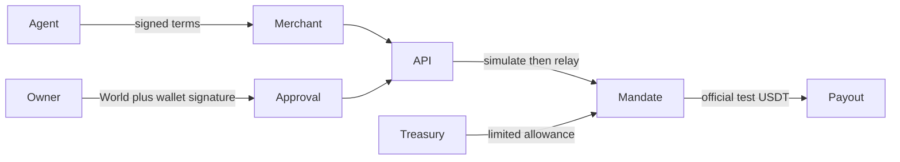

# Countersign: bounded payments for AI agents

**Current stage:** implemented prototype with local tests. Real Whitechain deployment/payment, real World issuer sign-in and browser journey remain unverified.

An agent can request a purchase; the treasury's mandate determines whether it is permitted. The implemented contract checks the signed merchant, payout/version, order, nonce, epoch, expiry and spending caps. Above-threshold payments require owner-wallet approval and a designated attestor signature tied to fresh World verification. Local tests exercise these boundaries; they do not establish live provider integration or production security.

**Implemented:** contracts, bounded relay/ledger, confirmed-log observer, merchant/agent SDKs, separate attestor, owner/approval/merchant/receipt/demo pages, refund preparation, WebSocket invalidations and source deployment configuration.

**Evidence:** prior human laptop suite75 Solidity tests; current backend/helper counts in STATUS; signed local JWT fixtures; UI lint/types. New AdversarialEdges tests are unexecuted. Playwright tests are written but not run. No audit, measured fee/latency or real settlement claim.

**Missing:** real deployment/source verification and USDT payment, real World identity success/failure, two live demo runs, browser tests, hosted URL/remote CI, provenance decision and submission video. Links remain TODO-HUMAN until supplied in deployed.json.

**Commercial hypothesis:** companies pay for bounded agent payments and sponsored execution. Actual billing and customer validation are not implemented evidence.

**Provenance:** prior Chupke/UI and EzPayz material are disclosed in BUILD_REPORT. Scale initial-setup gas eligibility and fresh/Continuity eligibility require human/staff answers.
